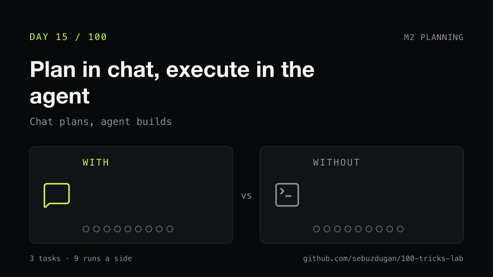
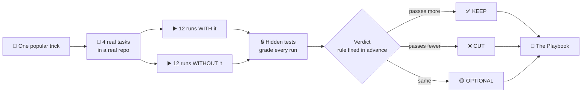
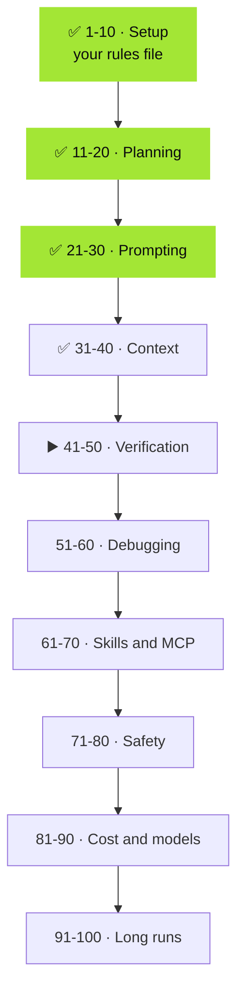

<h1 align="center">100 AI coding tricks, tested</h1>

<p align="center">
One popular AI coding tip a day, for 100 days.<br>
Run on real code with the trick and without it, graded by tests the agent never sees.<br>
<b>Every run, diff and log in this repo.</b>
</p>

<p align="center">
<a href="https://sebuzdugan.com/newsletter?utm_source=github&amp;utm_medium=readme&amp;utm_campaign=100-tricks">Get the tricks that held up each week in The Top K, free every Friday →</a>
</p>

<p align="center">
  
</p>

## Why

Most AI coding advice is somebody's good day. This is a measurement: same repo, same tasks, same model, one thing changed.

Nothing is cherry-picked. Days where the trick did nothing get posted too.

## How one day works



The verdict rule is written down **before** the runs, in [PROTOCOL.md](PROTOCOL.md). Every change to it is dated in that file's log.

## The Playbook so far

| Day | The trick | Result | Verdict |
|---|---|---|---|
| 1 | The viral 65-line rules file | 7/12 vs 7/12 | 🟡 optional |
| 2 | Let `/init` write the rules file | 10/12 vs 10/12 | 🟡 optional |
| 3 | Short rules file (49 lines) vs long (582) | 8/12 vs 8/12, short ran faster | ✅ keep |
| 4 | The SuperClaude framework | 7/12 vs 9/12 | ❌ cut |
| 5 | One rules file per package | 8/12 vs 8/12 | 🟡 optional |
| 6 | An ARCHITECTURE.md map, read first | 9/12 vs 7/12 | ✅ keep |
| 7 | Build and test commands in the rules file | 10/12 vs 7/12 | ✅ keep |
| 8 | Four "NEVER do X" rules | 10/12 vs 8/12, but 5 rule breaks either way | 🟡 optional |
| 9 | An 11-month-old rules file vs none | 9/12 vs 8/12 | 🟡 optional |
| 10 | A hook that blocks the action vs a written rule | 7/12 vs 7/12 | 🟡 optional |
| 11 | Plan mode first, then approve | 6/12 vs 8/12 | ❌ cut |
| 12 | Let the agent interview you first | 7/12 vs 9/12 | ❌ cut |
| 13 | Write SPEC.md, then build in a fresh session | 8/12 vs 7/12 | 🟡 optional |
| 14 | GitHub Spec Kit vs plan mode | 6/12 vs 6/12, 2.4x the time | ❌ cut |
| 15 | Plan in a plain chat, build in a fresh agent | 6/12 vs 6/12, 45% cheaper | ✅ keep |
| 16 | Type `ultrathink` before the task | 8/12 vs 7/12, 56% more thinking | 🟡 optional |
| 17 | Make the agent tick off a TASKS.md checklist | 10/12 vs 9/12, ticks didn't track passes | 🟡 optional |
| 18 | BMAD Method's build workflow (plan, code, AI review) | 8/12 vs 7/12, 5x the time | 🟡 optional |
| 19 | Ask for 3 approaches, then a fixed rule picks | 5/12 vs 6/12, rule skipped the spec | 🟡 optional |
| 20 | Write the failing test first, then code | 6/9 vs 8/9, never ran its tests on 3 of 9 | ❌ cut |
| 21 | "You are a senior engineer" role line | 6/12 vs 6/12, 33% costlier | ❌ cut |
| 22 | One code example vs one sentence for a style | 7/12 vs 7/12, fully styled 25% vs 42% | 🟡 optional |
| 23 | Wrap prompt sections in XML tags | 8/12 vs 8/12, same tasks passing | 🟡 optional |
| 24 | "This is very important to my career" line | 8/12 vs 8/12, 12% slower | 🟡 optional |
| 25 | Write the key rule in ALL CAPS | 8/12 vs 7/12, comment breaks 0 vs 1 | 🟡 optional |
| 26 | Detailed task prompt vs two sentences | 6/12 vs 5/12, same time and cost | 🟡 optional |
| 27 | Guardrails as "don't" rules vs positive rules | 8/12 vs 10/12, rule breaks 4 vs 3 | 🟡 optional |
| 28 | Paste the full failing output vs one sentence | 5/12 vs 2/12, same time and cost | ✅ keep |
| 29 | A "be concise" line before the task | 6/12 vs 7/12, 26% fewer output tokens | 🟡 optional |
| 30 | Restate the task before coding | 8/12 vs 6/12, the gap is two runs on one task | ✅ keep |
| 31 | /compact every 5 requests vs auto-compaction | 122/150 vs 114/150 requests kept, about 11 min slower | 🟡 optional |
| 32 | /clear every 5 requests vs one long session | 104/150 vs 124/150 requests kept, chat-only rules lost on clear | ❌ cut |
| 33 | Handoff note every 5 requests vs /compact | 117/150 vs 118/150 requests kept, money rule broke 2 vs 8 times | 🟡 optional |
| 34 | @-name the relevant files in every request | 120/150 vs 126/150 requests kept, reads and searches 186 vs 393 | 🟡 optional |
| 35 | A Repomix pack of the repo, read first every 5 requests | 120/150 vs 122/150 requests kept, real-file reads 417 vs 389 | 🟡 optional |
| 36 | Context7 docs server for a library newer than the model | 7/12 vs 0/12, faster and cheaper | ✅ keep |
| 37 | One rule in CLAUDE.md vs said once in request 1 | 7/12 vs 5/12 clean runs over 15 requests | ✅ keep |
| 38 | Paste the library docs vs give the links | 11/12 vs 3/12, links at twice the cost | ✅ keep |
| 39 | Keep a NOTES.md the agent re-reads | 124/150 vs 127/150 requests kept, 11 compactions | 🟡 optional |
| 40 | Paste the whole codebase into each fresh session | 108/150 vs 101/150 requests kept, 43% pricier | 🟡 optional |
| 41 | One system-card sentence on an impossible test | cheated 12/18 vs 0/18 | ✅ keep |
| 42 | A bigger model reviews the diff in a fresh session | 16/18 vs 7/18 (Opus vs Haiku reviewer) | ✅ keep |

**Module 4, after 10 days of long sessions:** 3 kept, 1 cut, 6 optional. No long-session trick helped here. Missing docs and CLAUDE.md rules did.

**Module 3, after 24 runs a day:** wording rarely moved passes. Pasted errors did. Passes followed test output.

**Module 2, after 234 runs:** every build followed what was written first (plan, spec, answers, checklist, tests), right or wrong. No planning step clearly added passes; only the half-cent chat plan earned its cost.

**Module 1, after 240 runs:** what changed the outcome was telling the agent how to build and test its own work. Not how strictly the rules were worded.

A new row lands here the day its post goes live.

## The road



## What's in here

| Folder | What you'll find |
|---|---|
| `runs/dNN/` | every run of that day: the verdict, each diff, each step the agent took |
| `tricks/dNN/` | the exact files that made up the trick |
| `tasks/` | the four tasks, and the hidden tests that grade them |
| `plan/` | all 100 days: the trick, the source, what to watch for |
| `PROTOCOL.md` | the rules, including the verdict rule and every change to it |

**The setup:** an AI coding agent (Claude Code on Haiku 4.5) working headless in a copy of a real open-source repo, four tasks, three runs per task per side. A budget model on purpose: stronger models passed almost everything, so no trick could show a difference.

<details>
<summary><b>Run it yourself</b></summary>

```bash
harness/setup_base.sh                         # rebuild the baseline repo
export LAB_CLAUDE_CONFIG_DIR=~/.claude-lab    # a clean agent config, so your own setup stays out of the runs
python3 harness/run.py d01 --dry-run          # prepare the copies, confirm the graders fail on the baseline
python3 harness/run.py d01                    # the day's runs, then the verdict
harness/publish_day.sh d01                    # commit and push that day's raw runs
```

A day is defined by `tricks/dNN/trick.json`: the tasks, the model, and what each side gets (files copied into the repo copy, a prompt prefix, a different model, extra tools, an extra checker). Copy `tricks/d01/trick.json` to start one.

</details>

## Follow along

**The tricks that held up each week land in [The Top K](https://sebuzdugan.com/newsletter?utm_source=github&utm_medium=readme&utm_campaign=100-tricks), a free Friday email with the numbers.**

The daily results go out as a 60-second video and a post with the numbers: [YouTube](https://sebuzdugan.com/l/yt) · [X](https://sebuzdugan.com/l/x) · [Medium](https://medium.com/@sebuzdugan)

Day cards use [Lucide](https://lucide.dev) icons (ISC).
